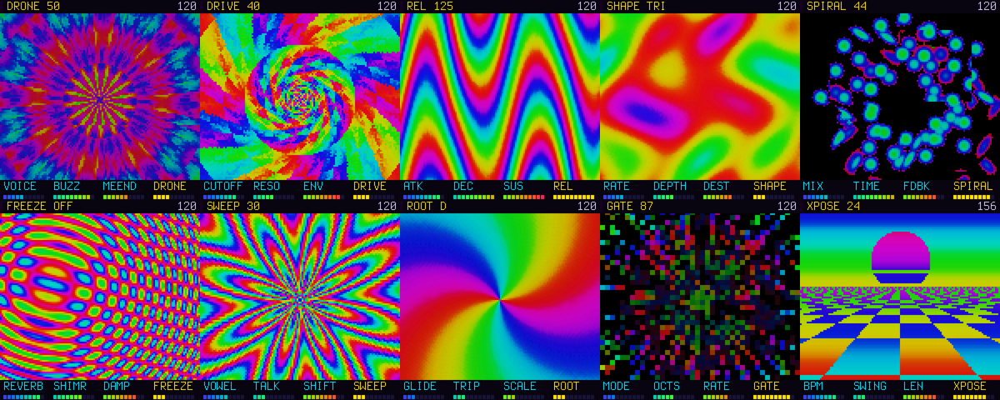

# TRIPDECK

**A psychedelic synth for the M-VAVE FM-1.** Every screen is a full-screen animated picture, and the four knobs of the screen change the
sound and the picture together. Sitar and tamboura, dreamy pads, organ through a Leslie, FM bells; a shimmering, freezable reverb,
a vowel filter, an echo that spirals in pitch, scale lock, and a TRIP mode that lets the patch wander on its own.

<p align="center"></p>

> **Status: 0.2, runs on the FM-1.** Tested on the device. Identity `FM-1_908`. Package: `build/tripdeck.fwsc` (made by `./build.sh`).

## What it does

| | |
| --- | --- |
| **Ten pictures** | OSC, FLT, ENV, LFO, DLY, REV, VOX, GLO, ARP, SEQ: a kaleidoscope, a tunnel, rainbow waves, plasma, video feedback, ripples, a rose window, a galaxy, a starfield and a chequered horizon. The four knobs of the page are the picture's four parameters. |
| **HOME** | Tap: the picture <-> the plain parameters ([docs/parameters.png](docs/parameters.png)). Double-tap: mutate the patch. Hold: panic. |
| **Four voices** | PAD (detuned oscillators, tape wobble), SITAR (a plucked buzzing string, with a tamboura drone under it), ORGAN (drawbars through a rotating speaker), BELL (FM bells and electric piano). |
| **Effects** | Spiral echo, shimmer reverb, reverb freeze, vowel filter, and the patch LFO. |
| **Scale lock** | Keys, MIDI, arpeggiator and sequencer snap to major, minor, dorian, phrygian, bhairav, pentatonic or whole tone scales, in any key. |
| **TRIP** | The knobs that colour the sound drift slowly by themselves. |
| **What you hear is what you see** | Every note flashes the picture; cutoff, resonance, reverb, the LFO and the held note colour it. |
| **Play** | 4 voices, arpeggiator, 32-step sequencer, 8 patches, USB audio. |
| **MIDI** | In from an external keyboard over the **TRS jack** (DIN-to-TRS type A cable) or USB: notes (through the scale lock), pitch wheel, program change, all-notes-off, six CCs. Out over USB: the keys, the arpeggiator and the sequencer. |

The manual is [docs/MANUAL.md](docs/MANUAL.md).

## Build and install

You need Linux on x86-64 (or Windows with WSL, or macOS with Docker), Python 3 with Pillow, the JieLi toolchain
and three files of the JieLi AC79 SDK:

```sh
pip3 install Pillow mido python-rtmidi
tools/get_toolchain.sh                      # JieLi's clang for the chip, to ~/.jieli/toolchain
git clone --depth 1 --branch AC79NN_SDK_V1.2.1_2023-12-13 \
    https://gitee.com/Jieli-Tech/fw-AC79_AIoT_SDK.git ~/fw-AC79_AIoT_SDK
```

`JIELI_TOOLCHAIN` and `AC79_SDK` point elsewhere if your copies live somewhere else. Then:

```sh
tests/run_host.sh tests/pages.txt                # hear it and see it on your computer: build/host/tripdeck.wav and screen PNGs
./build.sh                                       # -> build/tripdeck.fwsc (fails on what would brick the FM-1)
python3 tools/fm1_install.py build/tripdeck.fwsc # over USB; asks before it writes, restarts into your build
python3 tools/fm1_install.py --info              # what runs on the connected FM-1
```

The loop is: change the code, run it on the host, build, install. Installing firmware is at your own risk, and the first start of
TripDeck replaces the settings saved by an earlier TripDeck or CyberDeck. Back to another firmware, or to the official one, with the
[FM-1 Firmware Hub](https://fm1.designburgapps.com) in Chrome or Edge.

### The host and its tests

`tests/run_host.sh` runs `firmware/src/tripdeck.c` on your computer with a script: `tests/host.c` reads one line per event
(`T keys MASK`, `T btn ID [MS]`, `T enc ID N`, `T param IDX VAL`, `T midi ST D1 D2`, `T uart B0 B1 ...`, `T shot`, `T splash`, `T end`). The scripts in
`tests/` go through every page (`pages.txt`), the loading screen (`boot.txt`), the knobs, the sequencer, and mutate. `midi.txt` feeds raw bytes to the TRS-jack parser and checks the notes sent out over USB: `tests/run_host.sh tests/midi.txt > build/host/midi-trace.txt; python3 tests/check_midi.py build/host/midi-trace.txt`.

### When it goes wrong

- **It crashes:** the screen shows where (the PC), then the FM-1 restarts. Twice at boot and it goes to the USB rescue by itself.
- **It won't start at all:** hold **OCT-** while switching on: the USB rescue, no sound, only the updater. Install a working build
  (or another firmware from the hub) from there.
- **The build refuses:** it checks for a 64-bit division, a call into the chip ROM, too much RAM, a register touched outside `hal/`.
  [docs/RULES.md](docs/RULES.md) says why each one matters.

## How it is made

```
firmware/src/tripdeck.c    parameters, patches, the audio engine and its chain, the arpeggiator and sequencer, settings, the screens
firmware/src/voices.h      sitar, organ, FM bell, the tamboura, the Leslie, the reverb (shimmer, freeze)
firmware/src/fx.h          the pitch shifter (spiral echo, shimmer) and the vowel filter
firmware/src/scene_vis.h   the ten pictures and the heads-up display
firmware/src/scene_audio.h what the sound and the pictures share (the note strike, the level, the LFO)
firmware/src/platform.c    the plumbing (boot, USB, updates, audio ISR, settings): Felucca's platform as SLOOP carries it
```

Integers only (no float, no 64-bit division); the audio runs in an interrupt with 5.8 ms per 256 frames. More in
[docs/API.md](docs/API.md) (everything `platform.c` gives you) and [docs/RULES.md](docs/RULES.md) (the chip's rules).
[docs/MAKE-IT-YOURS.md](docs/MAKE-IT-YOURS.md) says how to make a firmware of your own from this one: a package identity of your own, releases, the hub.

## License

GPL-3.0-only, as Felucca and SLOOP: you may change and share it, and whoever gets your firmware gets its source.
Details, credits and third-party parts in [LICENSING.md](LICENSING.md).

TripDeck is by anonymousacademe, built on CyberDeck and on Dinghy (zvenson). The platform is Copyright (C) 2026 Leo Kuroshita (@kurogedelic),
Hügelton Instruments ([Felucca](https://github.com/hugelton/Felucca)), with SLOOP's changes (isod89, [SLOOP](https://github.com/isod89/sloop-fm1)).
